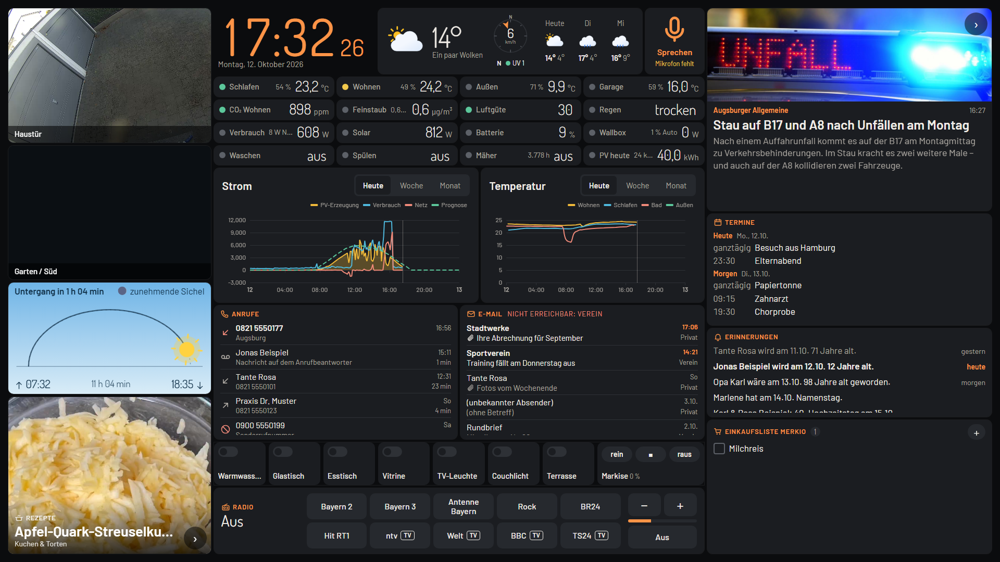
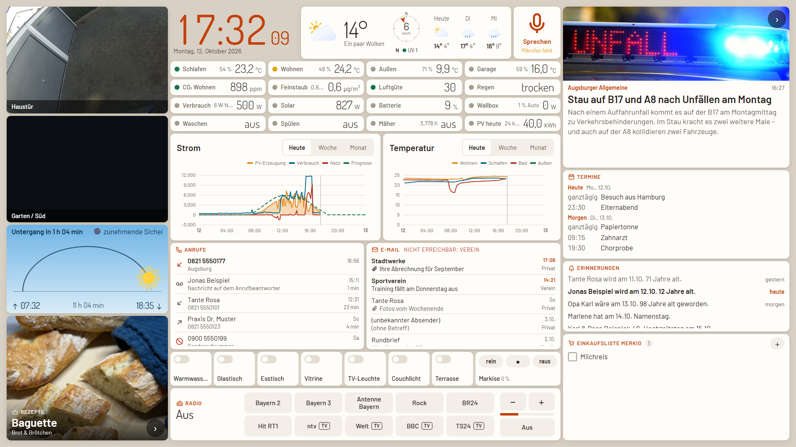
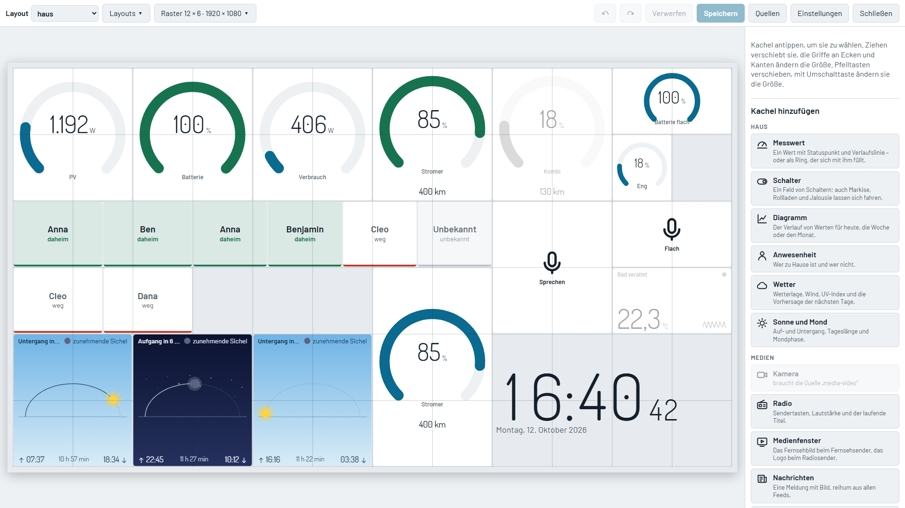
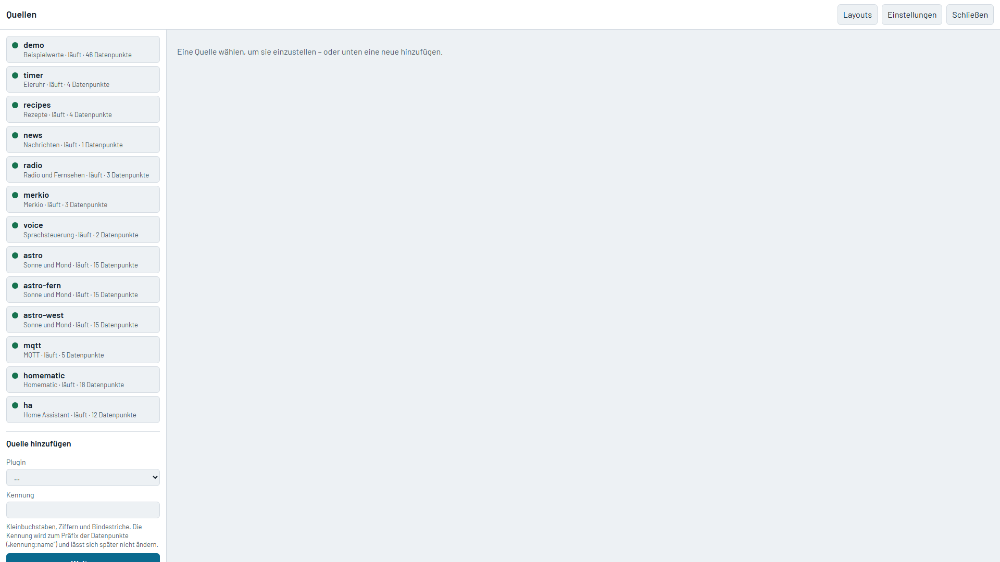
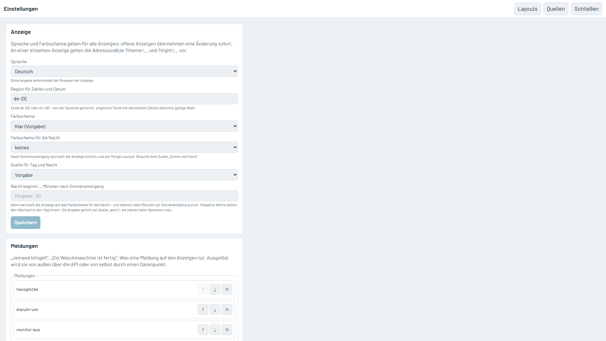

# Culinola

**The home dashboard for the screen in your kitchen.** Culinola brings your house, your media and your family's day together on one touch display: readings and switches, charts, cameras, radio and TV, news, calendar, shopping list and recipes – arranged the way you want, without writing a line of configuration.



## Why Culinola

- **One screen, everything at a glance.** No scrolling, no menus: a grid of tiles that fills the display and scales with it.
- **Works with what you have.** openHAB, Home Assistant, Homematic, MQTT (Tasmota, Zigbee2MQTT …), FRITZ!Box, IMAP mail, Google Calendar, RSS, go2rtc cameras – each is a plugin, and a tile does not care which system a value comes from.
- **Set up in the browser.** Drag tiles into place, pick datapoints from a searchable list, add sources and credentials, create access tokens – from your desk or your phone, while the kitchen display keeps running and picks up every change without a restart.
- **More than a smart-home panel.** Internet radio and live TV, your cameras, the newest e-mails, calls from the FRITZ!Box and an egg timer on the clock are built in – no extra apps, no extra screens.
- **Made for touch and for the whole family.** Tap the clock for an egg timer, tap a recipe to cook from it, put its ingredients on the shopping list, ask by voice how warm it is outside.
- **Yours.** Runs on your own hardware, in your own network. The source is open to read and change, and free for private and other noncommercial use.

## A look around

| | |
|---|---|
|  **Themes** – six colour themes, with an automatic switch at sunset. |  **Layout editor** – move, resize, add and configure tiles on a true-to-scale preview. |
|  **Sources** – add and configure connections; each one restarts on its own and tells you what it found. |  **Settings** – language, themes, on-screen messages and access tokens. |

The kitchen display shows a real installation; calls, e-mails, appointments and reminders in it are made up. The setup pages show the built-in test instance.

## What is in the box

**Tiles:** clock with egg timer and stopwatch · value with status and trend, or as a gauge · switches and covers · charts · presence · weather · sun and moon · camera · radio and TV · news · web page · image · calendar · reminders · calls · e-mail · shopping and to-do lists · recipes · voice.

**Sources:** openHAB · Home Assistant · Homematic (CCU2, CCU3, RaspberryMatic) · MQTT · FRITZ!Box · IMAP · Google Calendar and Contacts · RSS · Merkio lists · forecast.solar · go2rtc cameras and streams · internet radio · recipes from Markdown files · sun and moon, calculated offline.

**And:** on-screen messages with sound and camera ("Someone is at the door") · day and night themes · German and English · an HTTP and WebSocket API that the interface itself uses · access tokens with three levels.

## Try it

You need Node.js 22.18 or newer.

```bash
npm install
npm run build
npm start
```

Open <http://localhost:8090>. Without a configuration of your own, Culinola starts with made-up demo values. Add `?layout=main&edit` to the address to open the layout editor, or go straight to `?edit=sources` to connect your own systems.

With Docker:

```bash
docker build -f docker/Dockerfile -t culinola .
docker run -d -p 8090:8090 -v ./data:/data culinola
```

Everything of yours – configuration, credentials, recipes – lives in the `data` folder and never in the repository.

> **Before you expose it:** out of the box the API is open to everyone on your network. Create an access token under *Settings → Access* and put HTTPS in front before reaching it from outside your home network.

## Status

Culinola is young. It was built for its author's kitchen display running against openHAB, and every connector is covered by automated tests against stand-ins – but not every plugin has been exercised against every real device, and the setup pages are new. Expect rough edges and please report them.

The interface is available in German and English. Messages produced by the core (rejected input, connection errors) and the detailed handbook are still German only; translating both is in progress.

## Documentation

- [Architecture](docs/architecture.md): how core, plugins and interface fit together
- [Handbook](docs/handbuch.de.md) (German): every tile, every plugin, the API and access control
- [Testing](docs/testen.md) (German): what is tested automatically and the manual checklist
- [Google account setup](docs/google-einrichten.md) (German)
- [Contributing](CONTRIBUTING.md) and the [Contributor License Agreement](CLA.md)
- [Security](SECURITY.md)

## License

Culinola is source-available under the [PolyForm Noncommercial License 1.0.0](LICENSE): you may use, change and share it for any noncommercial purpose – at home, for a club, a school, for trying it out. Commercial use – selling it, bundling it with hardware, offering it as a service or installing it for customers – needs a separate licence; write to <mail@christa-web.de>. See also [NOTICE](NOTICE).

Culinola builds only on permissively licensed dependencies; this is checked on every build.
